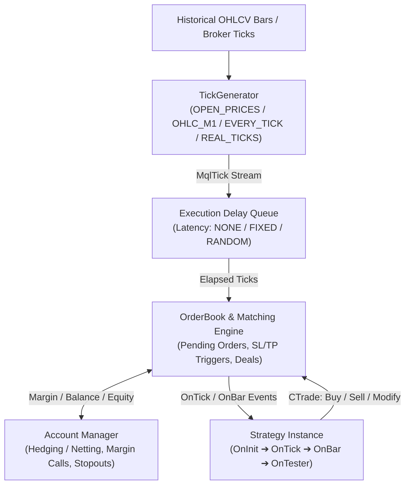
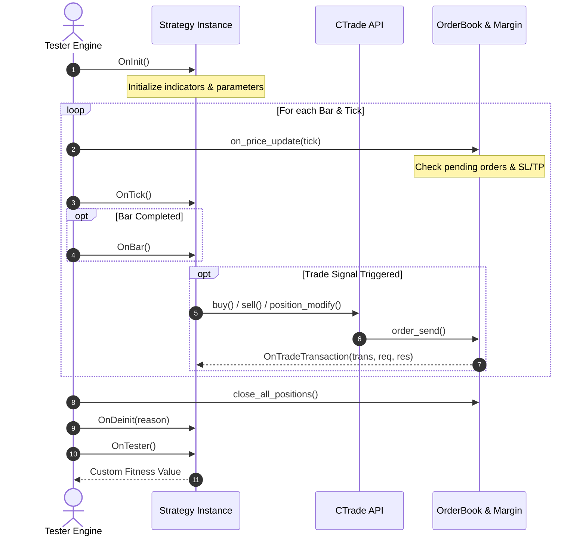
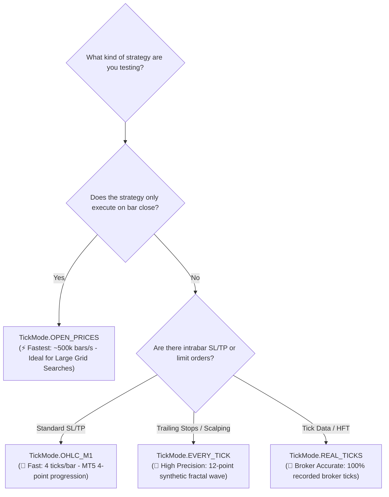
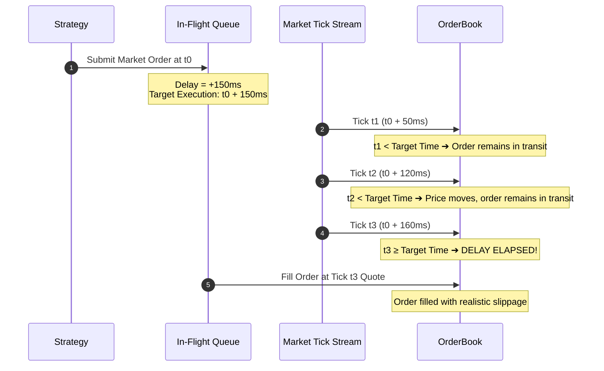
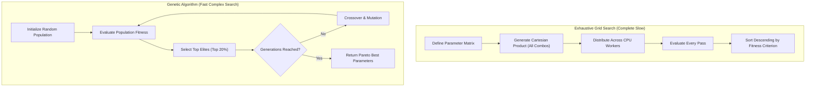

# EdgeEngine v2.0.0 — Open-Source MetaTrader 5 Strategy Tester Replica

> **100% Genuine Broker Data • 1:1 MT5 Accounting & Execution Lifecycle • C++17 Core with AVX2 & Python Bindings**  
> An open-source, general-purpose simulation engine replicating the execution semantics, tick generation, latency queues, and optimization algorithms of the MetaTrader 5 Strategy Tester.

---

## 📑 Table of Contents
1. [Architecture & Design Philosophy](#1-architecture--design-philosophy)
2. [Directory Structure](#2-directory-structure)
3. [Installation & Quick Setup Guide](#3-installation--quick-setup-guide)
4. [Downloading & Storing 100% Broker Data](#4-downloading--storing-100-broker-data)
5. [Implementing Custom Strategies](#5-implementing-custom-strategies)
6. [Simulation Modes (How to Choose the Right Mode)](#6-simulation-modes-how-to-choose-the-right-mode)
7. [Execution Latency & Slippage Simulation](#7-execution-latency--slippage-simulation)
8. [Interactive Step-by-Step & Visual Replay](#8-interactive-step-by-step--visual-replay)
9. [Optimization & Hyperopt Guide](#9-optimization--hyperopt-guide)
10. [Test Suite & Verification](#10-test-suite--verification)

---

## 1. Architecture & Design Philosophy

Unlike simple backtest scripts that calculate hypothetical returns by multiplying signals by bar returns, **EdgeEngine is an event-driven 1:1 software replica of the MetaTrader 5 Strategy Tester**.



### Core Tenets:
1. **Transaction Ledger Integrity**:
   - Follows MT5's exact transaction flow: `MqlTradeRequest` $\to$ `Order` $\to$ `Deal` $\to$ `Position`.
   - Positions are never treated as abstract numbers; every open position has ticket identifiers, entry timestamps, open price, volume, SL/TP levels, swap accruals, and continuous tracking of Maximum Favorable Excursion (MFE) and Maximum Adverse Excursion (MAE).
2. **Point Specification Accuracy**:
   - PnL is computed strictly from the instrument's contract specifications:
     $$\text{PnL} = \frac{\Delta\text{Price}}{\text{TradeTickSize}} \times \text{TradeTickValue} \times \text{Volume}$$
   - Includes full spread modeling (fixed or dynamic per-bar spread arrays), round-turn commissions, and overnight holding swaps (long/short).
3. **No Synthetic Fallbacks for Price Data**:
   - Strictly adheres to the project protocol: **all testing and optimizations operate exclusively on real broker historical candles** directly downloaded from the MetaTrader 5 terminal server.

---

## 2. Directory Structure

```
edge_engine/
├── core/
│   ├── include/                    # Header-only C++17 Core Engine
│   │   ├── mql_types.hpp           # MT5 structs (MqlTick, MqlRates, MqlTradeRequest, Deal, etc.)
│   │   ├── account.hpp             # Balance, equity, leverage, margin requirement, stop-out
│   │   ├── order_book.hpp          # Matching engine, in-flight latency queue, pending orders
│   │   ├── strategy_base.hpp       # Abstract Strategy base class & TradeContext (CTrade)
│   │   ├── tick_generator.hpp      # MT5 intrabar tick wave synthesizers (OHLC_M1, EVERY_TICK)
│   │   ├── interactive_tester.hpp  # Step-by-step visual & interactive replay engine
│   │   ├── tester.hpp              # Master simulation loop orchestrator
│   │   └── types.hpp               # Shared enums (TickMode, LatencyMode, OptAlgo, ExitMethod)
│   │
│   └── src/
│       ├── bindings.cpp            # pybind11 module for legacy fast engine (edge_engine_core)
│       └── tester_bindings.cpp     # pybind11 module for general-purpose tester (edge_tester)
│
├── python/edge_engine/             # High-Level Python Package
│   ├── __init__.py                 # Top-level exports (BacktestEngine, StrategyOptimizer, etc.)
│   ├── optimizer.py                # Multi-core Grid & Genetic StrategyOptimizer
│   ├── symbol_spec.py              # Symbol contract specifications and helpers
│   └── param_builder.py            # Parameter grid utilities
│
├── tests/                          # 38 Unit & Parity Tests
│   ├── test_advanced_features.py   # Latency queues, OHLC_M1, Interactive replay, OnTester
│   ├── test_general_tester.py      # MT5 CTrade, accounting, margin call & stopout integrity
│   └── test_parity.py              # Strict numerical parity tests vs. legacy engine
│
├── CMakeLists.txt                  # Build configuration
└── pyproject.toml                  # Packaging and build instructions
```

---

## 3. Installation & Quick Setup Guide

### 3.1 Prerequisites

Before building EdgeEngine, ensure you have the following installed on your system:

| Component | Minimum Version | Notes |
| :--- | :--- | :--- |
| **Python** | 3.10 – 3.13 (64-bit) | Standard CPython distribution recommended |
| **CMake** | 3.18+ | Ensure `cmake` is added to your system `PATH` |
| **C++17 Compiler** | MSVC (VS 2022) / GCC 9+ / Clang 10+ | Supports AVX2 vectorization instructions |
| **Git** | 2.30+ | For cloning the repository and submodules |

#### Compiler Details by Platform
- **Windows**: Install [Visual Studio 2022](https://visualstudio.microsoft.com/) (Community or Professional) with the **"Desktop development with C++"** workload selected, or the standalone **Visual Studio Build Tools**.
- **Linux (Debian/Ubuntu)**:
  ```bash
  sudo apt update && sudo apt install -y build-essential cmake python3-dev
  ```
- **macOS**:
  ```bash
  xcode-select --install
  brew install cmake
  ```

---

### 3.2 Step-by-Step Setup

#### Step 1: Clone the Repository
```bash
git clone https://github.com/dante-bills1/edge_lab.git
cd edge_lab
```

#### Step 2: Create and Activate a Virtual Environment
It is recommended to build and run inside an isolated virtual environment:

- **Windows (PowerShell)**:
  ```powershell
  python -m venv .venv
  .\.venv\Scripts\Activate.ps1
  ```
- **Linux / macOS (Bash/Zsh)**:
  ```bash
  python3 -m venv .venv
  source .venv/bin/activate
  ```

#### Step 3: Upgrade Pip & Install Build Toolchain
EdgeEngine utilizes `scikit-build-core` and `pybind11` for high-performance C++ compilation:
```bash
python -m pip install --upgrade pip
pip install "scikit-build-core>=0.9" "pybind11>=2.12"
```

#### Step 4: Build and Install EdgeEngine

Choose one of the following install modes:

- **Option A: Development / Editable Install (Recommended for research & iteration)**
  Compiles the C++ extension in-place so edits to Python files are immediately reflected:
  ```bash
  pip install -e . --no-build-isolation
  ```

- **Option B: Full Install with Development & Testing Dependencies**
  Installs `pytest`, `pandas`, `numpy`, and benchmarking suites:
  ```bash
  pip install -e ".[dev]" --no-build-isolation
  ```

- **Option C: Standard Production Build**
  ```bash
  pip install .
  ```

---

### 3.3 Verification

1. **Smoke Test the Python & C++ Extension Import**:
   ```powershell
   python -c "import edge_tester as et, edge_engine as ee; print('EdgeEngine C++ core and Python package loaded successfully!')"
   ```

2. **Run the Automated Test Suite**:
   Execute the test suite to verify matching engine parity, accounting rules, and latency queues:
   ```powershell
   pytest tests/ -v
   ```

---

### 3.4 60-Second Quick Start

You can run an end-to-end backtest on synthetic or broker data in seconds:

```python
import numpy as np
import pandas as pd
import edge_tester as et

# 1. Generate 1,000 synthetic bars for instant testing
np.random.seed(42)
n_bars = 1000
close = 100.0 + np.cumsum(np.random.randn(n_bars) * 0.2)
high = close + np.random.rand(n_bars) * 0.3
low = close - np.random.rand(n_bars) * 0.3
open_p = close + np.random.randn(n_bars) * 0.1

df = pd.DataFrame({
    "time": np.arange(n_bars, dtype=np.int64),
    "open": open_p,
    "high": high,
    "low": low,
    "close": close,
    "tick_volume": np.full(n_bars, 100, dtype=np.int64),
    "spread": np.full(n_bars, 10, dtype=np.int32),
})

# 2. Configure Instrument Specs and Tester
spec = et.SymbolSpec()
spec.point = 0.01
spec.spread_val = 0.10

cfg = et.TesterConfig()
cfg.initial_deposit = 10_000.0
cfg.leverage = 100.0
cfg.tick_mode = et.TickMode.EVERY_TICK

# 3. Instantiate Engine and Run Test
tester = et.Tester(cfg, spec)
results = tester.run_test(df)

print("Backtest Complete!")
print(f"Ending Balance: ${results['ending_balance']:,.2f}")
print(f"Total Trades:   {results['total_trades']}")
print(f"Profit Factor:  {results['profit_factor']:.2f}")
```

---

## 4. Downloading & Storing 100% Broker Data

To guarantee 100% genuine broker data without synthetic curve-fitting, use the MetaTrader 5 Python API to download directly from the broker's terminal into high-performance Parquet storage.

### Data Downloader Script
Save and run this script to download genuine broker data:

```python
"""
download_data.py
Downloads 100% genuine broker candles directly from MetaTrader 5 and caches them as Parquet.
"""
import os
import MetaTrader5 as mt5
import pandas as pd

# List of symbols to download
SYMBOLS = [
    "Jump 75 Index",
    "Volatility 75 Index",
    "EURUSD",
]
TIMEFRAME = mt5.TIMEFRAME_M5
BARS_COUNT = 100_000
OUTPUT_DIR = "backtest_suite/historical_data_cache"

os.makedirs(OUTPUT_DIR, exist_ok=True)

if not mt5.initialize():
    raise RuntimeError(f"MT5 initialization failed: {mt5.last_error()}")

for symbol in SYMBOLS:
    print(f"Fetching {BARS_COUNT:,} bars for {symbol}...")
    mt5.symbol_select(symbol, True)
    
    # Ingest in chunks to prevent socket timeout
    chunk_size = 50_000
    pos = 0
    all_chunks = []
    
    while pos < BARS_COUNT:
        to_fetch = min(chunk_size, BARS_COUNT - pos)
        rates = mt5.copy_rates_from_pos(symbol, TIMEFRAME, pos, to_fetch)
        if rates is None or len(rates) == 0:
            break
        all_chunks.append(pd.DataFrame(rates))
        pos += len(rates)
        if len(rates) < to_fetch:
            break

    if not all_chunks:
        print(f"  Warning: No data returned for {symbol}")
        continue

    df = pd.concat(all_chunks, ignore_index=True)
    df = df.drop_duplicates(subset=['time']).sort_values('time').reset_index(drop=True)
    
    clean_name = symbol.lower().replace(" ", "_")
    output_path = os.path.join(OUTPUT_DIR, f"{clean_name}_100k_m5.parquet")
    df.to_parquet(output_path, engine="pyarrow", compression="snappy")
    print(f"  Saved {len(df):,} bars to {output_path}")

mt5.shutdown()
```

### Loading the Data for Backtesting
```python
import pandas as pd

df = pd.read_parquet("backtest_suite/historical_data_cache/jump_75_index_100k_m5.parquet")
# Ensure columns: open, high, low, close, time, tick_volume, spread
```

---

## 5. Implementing Custom Strategies

Strategies subclass `edge_tester.Strategy`. Both snake_case and MQL5 PascalCase method overrides are supported.

### Lifecycle Callbacks



- `on_init(self)` / `OnInit()`: Initialization hook. Return `et.INIT_SUCCEEDED` (0) or `et.INIT_FAILED` (1).
- `on_tick(self)` / `OnTick()`: Called on every price tick (synthetic or real).
- `on_bar(self)` / `OnBar()`: Called at every bar close.
- `on_trade_transaction(self, trans, req, res)` / `OnTradeTransaction(...)`: Event callback whenever an order or deal changes status.
- `on_deinit(self, reason)` / `OnDeinit(reason)`: Cleanup hook called after simulation finishes.
- `on_tester(self)` / `OnTester()`: Returns a custom scalar fitness value used during optimization.

### Trade API (`self.trade`)
The strategy has access to an MT5 `CTrade` equivalent via `self.trade`:

| Method | Description |
| :--- | :--- |
| `self.trade.buy(volume, sl=0.0, tp=0.0, comment="")` | Open a market Buy order |
| `self.trade.sell(volume, sl=0.0, tp=0.0, comment="")` | Open a market Sell order |
| `self.trade.buy_limit(volume, price, sl=0.0, tp=0.0)` | Place a pending Buy Limit order |
| `self.trade.sell_limit(volume, price, sl=0.0, tp=0.0)` | Place a pending Sell Limit order |
| `self.trade.buy_stop(volume, price, sl=0.0, tp=0.0)` | Place a pending Buy Stop order |
| `self.trade.sell_stop(volume, price, sl=0.0, tp=0.0)` | Place a pending Sell Stop order |
| `self.trade.position_close(ticket, volume=0.0)` | Close position by ticket |
| `self.trade.position_modify(ticket, sl, tp)` | Modify SL and TP of open position |
| `self.trade.order_delete(ticket)` | Cancel an active pending order |
| `self.trade.positions()` | List of active open positions (`ticket`, `volume`, `price_open`, `sl`, `tp`, `profit`, etc.) |
| `self.trade.orders()` | List of active pending orders |
| `self.trade.iClose(shift=0)` | Close price of bar (0 = current, 1 = previous) |
| `self.trade.iOpen(shift=0)` | Open price of bar |
| `self.trade.iHigh(shift=0)` | High price of bar |
| `self.trade.iLow(shift=0)` | Low price of bar |
| `self.trade.ask()` / `self.trade.bid()` | Current best market quote |
| `self.trade.account_balance()` / `equity()` | Current balance and floating equity |

### Example Strategy Implementation

```python
import edge_tester as et

class MovingAverageCross(et.Strategy):
    fast_period: int = 12
    slow_period: int = 26
    risk_lot: float = 0.1

    def on_init(self):
        self.fast_buffer = []
        self.slow_buffer = []
        return et.INIT_SUCCEEDED

    def on_bar(self):
        t = self.trade
        if t.bars() < self.slow_period + 1:
            return

        # Calculate Moving Averages using historical bar accessors
        fast_sma = sum(t.iClose(i) for i in range(self.fast_period)) / self.fast_period
        slow_sma = sum(t.iClose(i) for i in range(self.slow_period)) / self.slow_period

        prev_fast = sum(t.iClose(i + 1) for i in range(self.fast_period)) / self.fast_period
        prev_slow = sum(t.iClose(i + 1) for i in range(self.slow_period)) / self.slow_period

        # Bullish Crossover
        if prev_fast <= prev_slow and fast_sma > slow_sma:
            if t.positions_total() == 0:
                t.buy(self.risk_lot, sl=t.ask() - 10.0, tp=t.ask() + 20.0)

        # Bearish Crossover
        elif prev_fast >= prev_slow and fast_sma < slow_sma:
            for pos in t.positions():
                t.position_close(pos.ticket)

    def on_tester(self):
        # Custom Fitness: Sharpe Ratio multiplied by Profit Factor
        res = self.trade.account_balance()
        return res
```

---

## 6. Simulation Modes (How to Choose the Right Mode)

EdgeEngine supports all 4 standard MetaTrader 5 tick generation models via `et.TickMode`:

```python
cfg = et.TesterConfig()
cfg.tick_mode = et.TickMode.OPEN_PRICES  # Set mode here
```



### Choosing the Right Mode

| Mode | Intrabar Steps | Speed | Best Used For |
| :--- | :---: | :---: | :--- |
| **`TickMode.OPEN_PRICES`** | 1 tick / bar | **Fastest** (~500k bars/sec) | Strategies that only execute logic on bar completion (e.g., standard Moving Average, MACD, Bar-Close signals). Ideal for rapid broad grid searches and parameter optimizations. |
| **`TickMode.OHLC_M1`** | 4 ticks / bar | **Fast** (~150k bars/sec) | The standard MT5 4-point intrabar progression ($\text{Open} \to \text{High/Low} \to \text{Low/High} \to \text{Close}$). Ideal for strategies with tight Stop-Loss or Take-Profit orders that could be triggered within the bar duration. |
| **`TickMode.EVERY_TICK`** | 12 ticks / bar | **Moderate** (~50k bars/sec) | MT5's fractal price generator synthesizing 12 price states across 3 sub-intervals. Ideal for precision backtesting trailing stops, breakeven triggers, and scalping logic. |
| **`TickMode.REAL_TICKS`** | Every actual tick | **Exhaustive** | Pure replay of recorded real broker tick history (bid, ask, tick volume). Used for high-frequency strategies and final validation runs. |

---

## 7. Execution Latency & Slippage Simulation

In real-world live trading, orders do not execute instantaneously. Price quotes fluctuate while an order travels across the network to the broker. EdgeEngine replicates MT5's latency queue.

### Latency Configuration

```python
cfg = et.TesterConfig()

# 1. Zero Latency (instant execution)
cfg.latency_mode = et.LatencyMode.NONE

# 2. Fixed Latency (e.g. 150ms delay)
cfg.latency_mode = et.LatencyMode.FIXED
cfg.latency_fixed_ms = 150

# 3. Random Latency (e.g. jitter between 50ms and 250ms)
cfg.latency_mode = et.LatencyMode.RANDOM
cfg.latency_min_ms = 50
cfg.latency_max_ms = 250
cfg.latency_seed = 42
```

### Mechanics



When an order is submitted at time $t$, it is assigned an execution time $t_{\text{target}} = t + \text{delay}$. The order is placed into an `in_flight_orders` queue. As market prices evolve, the order is only matched once a tick arrives with $t_{\text{tick}} \ge t_{\text{target}}$ at that future tick's price, naturally reproducing real market slippage.

---

## 8. Interactive Step-by-Step & Visual Replay

EdgeEngine includes `et.InteractiveTester` which mirrors MT5's Visual Tester. It allows you to pause, step bar-by-bar or tick-by-tick, and inspect floating metrics in real-time.

```python
import edge_tester as et

spec = et.SymbolSpec()
spec.point = 0.01
spec.spread_val = 0.10

cfg = et.TesterConfig()
cfg.tick_mode = et.TickMode.OPEN_PRICES

strategy = MovingAverageCross()
replay = et.InteractiveTester()

# 1. Initialize
replay.init(
    strategy,
    df["open"].to_numpy(), df["high"].to_numpy(),
    df["low"].to_numpy(), df["close"].to_numpy(),
    df["time"].to_numpy(), df["tick_volume"].to_numpy(),
    df["spread"].to_numpy(), spec, cfg
)

# 2. Step bar-by-bar
while not replay.is_done():
    replay.step_bar()
    
    # Query live state at any point
    current_bar = replay.current_bar()
    floating_equity = replay.account_equity()
    balance = replay.account_balance()
    margin_level = replay.account_margin_level()
    positions = replay.positions()
    
    if current_bar % 1000 == 0:
        print(f"Bar {current_bar}: Balance=${balance:,.2f}, Equity=${floating_equity:,.2f}, Positions={len(positions)}")

# 3. Finalize and extract complete report
result = replay.finish()
print(f"Backtest finished! Net profit: ${result.net_profit:,.2f}")
```

---

## 9. Optimization & Hyperopt Guide

EdgeEngine includes a dedicated multi-process `StrategyOptimizer` capable of running exhaustive grid sweeps and genetic algorithms across all CPU cores without Python GIL contention.

### Optimization Criteria (`OptimizationCriterion`)
Select which metric the optimizer should maximize:
- `OptimizationCriterion.CUSTOM`: Maximizes the return value of your strategy's `on_tester()` / `OnTester()` method.
- `OptimizationCriterion.BALANCE_MAX`: Maximizes ending balance.
- `OptimizationCriterion.PROFIT_FACTOR`: Maximizes Profit Factor.
- `OptimizationCriterion.EXPECTED_PAYOFF`: Maximizes average profit per trade.
- `OptimizationCriterion.DRAWDOWN_MIN`: Minimizes Maximum Drawdown %.
- `OptimizationCriterion.SHARPE`: Maximizes Sharpe Ratio.
- `OptimizationCriterion.RECOVERY_FACTOR`: Maximizes Recovery Factor.

### Exhaustive Grid Search vs. Genetic Algorithm



```python
from edge_engine import StrategyOptimizer
import edge_tester as et
import pandas as pd

df = pd.read_parquet("backtest_suite/historical_data_cache/jump_75_index_100k_m5.parquet")
spec = et.SymbolSpec()
spec.point = 0.01
spec.spread_val = 0.10

# 1. Configure the Optimizer
optimizer = StrategyOptimizer(
    strategy_cls=MovingAverageCross,
    symbol_spec=spec,
    criterion=et.OptimizationCriterion.SHARPE,
    algorithm=et.OptimizationAlgorithm.GENETIC,  # or EXHAUSTIVE
    max_workers=8,  # Distribute across 8 CPU cores
)

# 2. Define Parameter Search Space
param_grid = {
    "fast_period": [8, 10, 12, 14, 16],
    "slow_period": [20, 24, 28, 32, 36, 40],
    "risk_lot": [0.01, 0.02, 0.05],
}

# 3. Run Optimization
results = optimizer.optimize(
    df, 
    param_grid,
    generations=15,      # Genetic algorithm generations
    population_size=20,  # Population size per generation
)

# 4. View Top 3 Parameter Sets
print("Top 3 Configurations:")
for rank, pass_res in enumerate(results[:3], start=1):
    print(f"#{rank} | Fitness: {pass_res['fitness']:.3f} | Net Profit: ${pass_res['net_profit']:,.2f} | Sharpe: {pass_res['sharpe_ratio']:.2f}")
    print(f"     Params: {pass_res['params']}")
```

---

## 10. Test Suite & Verification

The engine is validated by an automated test suite verifying matching engine mechanics, accounting integrity, and MT5 parity:

```powershell
pytest tests/ -v
```

### Coverage
- **Advanced Feature Tests (`tests/test_advanced_features.py`)**: Validates `OHLC_M1` 4-tick generation, transit delay slippage queues, `InteractiveTester` replay methods, and `StrategyOptimizer` Grid/Genetic optimization passes.
- **Accounting & Margin Integrity (`tests/test_general_tester.py`)**: Tests margin calls, stop-out liquidations, Hedging vs. Netting, swap charges, historical price buffer queries, and deal log integrity.
